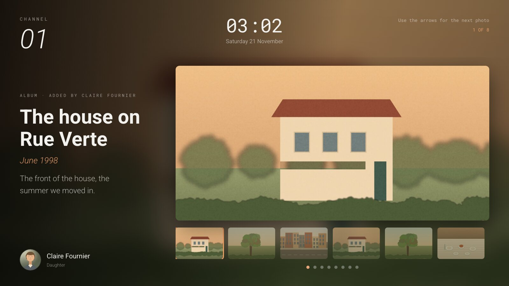
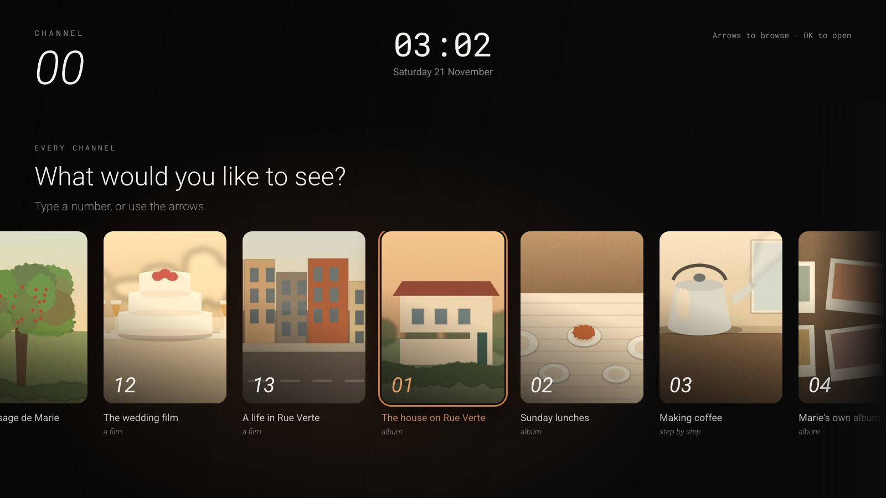
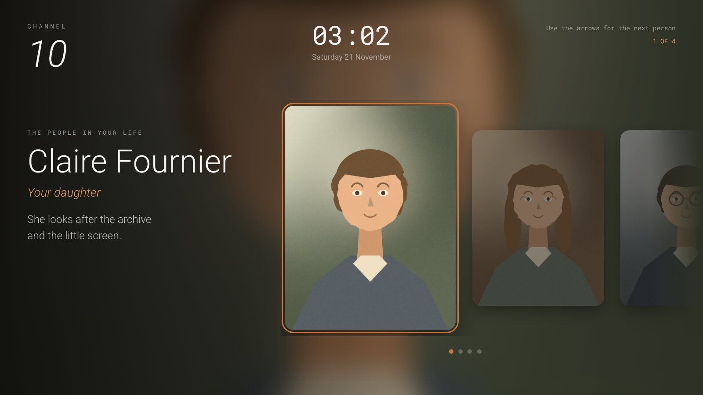
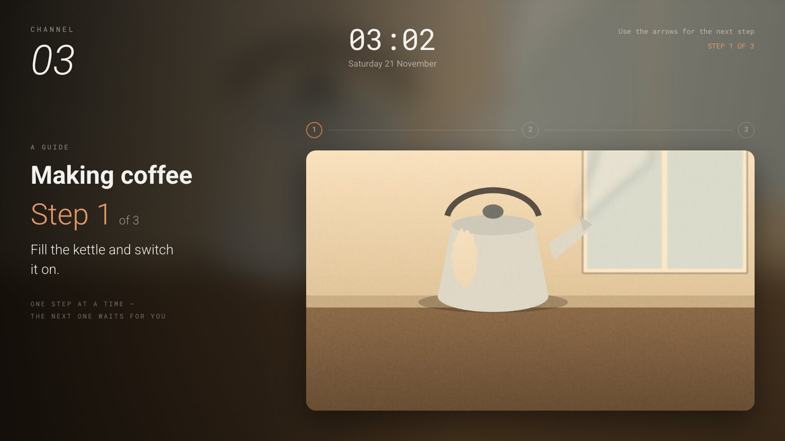
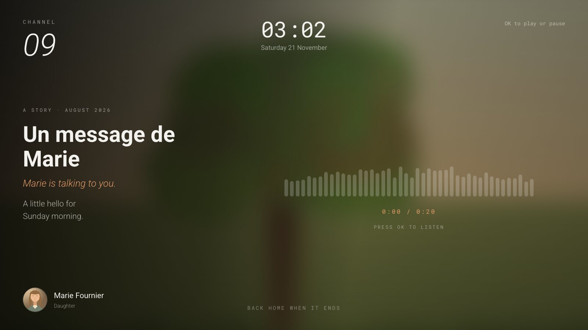
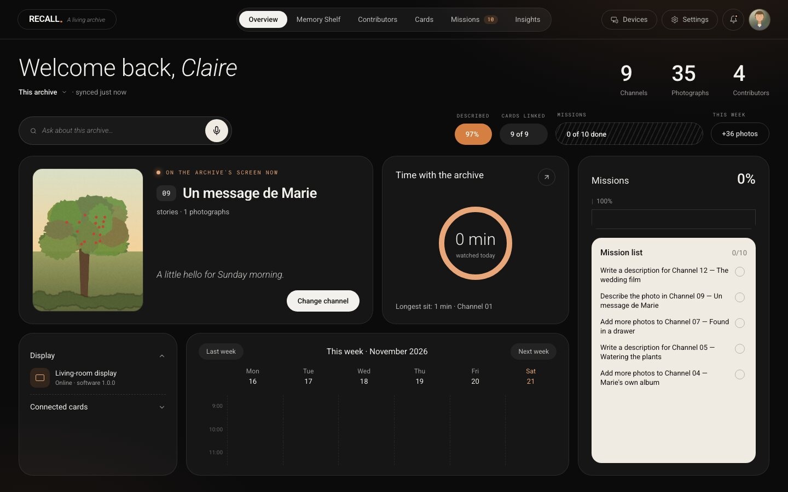
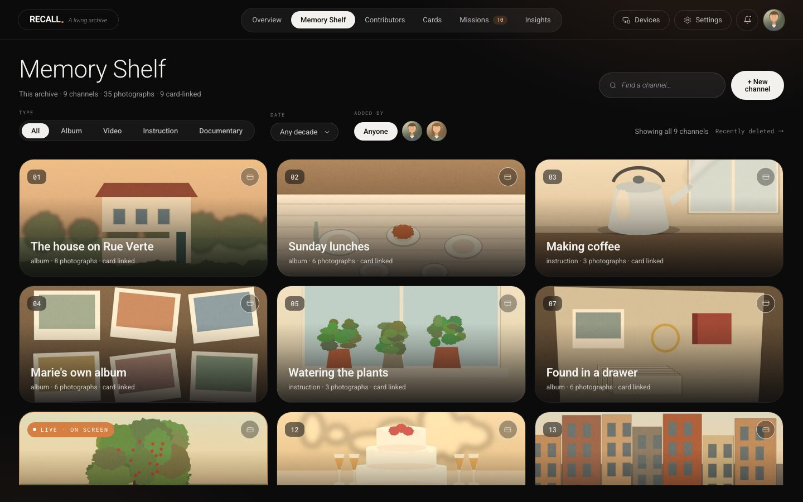
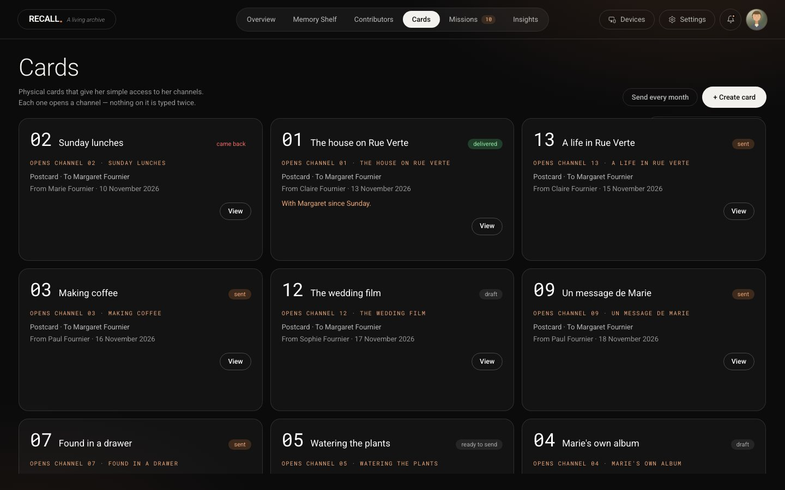
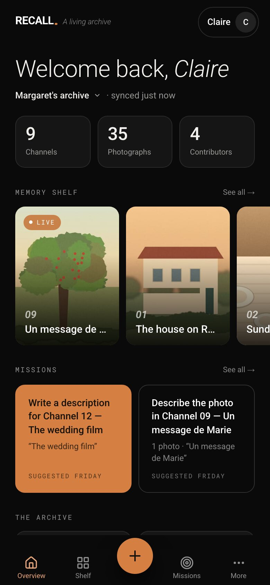

# Recall

**A television for someone living with dementia.** She lays a card on a small
reader, and the channel it names opens on her own screen: photographs, a voice,
a step-by-step guide, made for her by her family. They fill it from their
phones; she never has to learn anything new.

A clean snapshot of a private repository, shared for review.



---

## What it does

**For her.** Recall turns the screen she already knows into numbered channels.
Each channel is one thing: an album, a film, a voice message from a
grandchild, or a guide such as *Making coffee* that shows one step at a time
and never what comes next. She opens a channel by laying its card on the
reader, or by typing its two digits on a remote. Two numbers are always there:
**00** shows every channel, **10** shows the people in her life, with their
faces and one warm sentence each. She has no password, nothing to tap and
nothing to scroll; the arrows move, OK opens, and when a message ends the
screen goes home by itself.

**For the family.** A web workspace, on a laptop or a phone, where children,
grandchildren and carers add photographs, films and voice notes from wherever
they are, write the words that go with them, and see which channels she
returns to (it counts the memories she opens, and never scores her). Recall
points out what is missing (*"one photograph in Sunday lunches still has no
words"*), sends a real postcard that tells her which channel to type, and
lets the family take the whole archive with them as a ZIP with one offline
page that opens in any browser.

| Channel 00: every channel | Channel 10: the people in her life |
|---|---|
|  |  |
| **A guide: one step, nothing ahead** | **A voice message** |
|  |  |

| The family workspace | The memory shelf |
|---|---|
|  |  |
| **Postcards, one in every state** | **On a phone** |
|  |  |

Every screenshot shows the demo family described below, on a local database:
invented people, drawn pictures.

## The idea: a card on a reader, a channel on the TV

Recall began with one woman living with dementia, who used it at home for six
months. Voice assistants and AI had failed her; a number on a familiar screen
did not. In her words: *"It feels just like using my own television."*

So the input is the simplest thing that could work. The reader is an ordinary
**keyboard-emulating NFC reader**: when a card touches it, it *types* the
card's digits. The display already treats two typed digits as "go to that
channel", exactly as it does for a remote. No driver, no pairing, no app and
no server are involved in a scan, and any NFC card or sticker can carry a
number. A few numbers belong to the display itself (`00` every channel, `10`
family, `98` home, `99` admin), and a database constraint stops content from
ever claiming them. The family's side is deliberately unreachable by scan or
keypad.

## Why it is built this way

- **One trust boundary.** The browser never holds a database credential and
  never talks to the database. The Express API is the only holder of the
  Supabase service key. Every table has row-level security switched on with
  *no* policy at all, so an anonymous client is denied everything; both
  storage buckets are private, and media is streamed through API routes.
- **Two kinds of session.** `recall_device` answers "is this a trusted
  screen?" and lasts 30 days, so her display is never interrupted.
  `recall_profile` answers "who is at the keyboard?": 8 hours for family
  members, a year for her. Both are signed tokens in httpOnly, SameSite=Strict
  cookies, and every protected request re-reads the person's row: the token is
  a claim, the database is the truth.
- **Tenancy you can test without a database.** Every family-scoped query must
  filter on its archive. The test suite records every query the routes issue
  (`backend/src/__tests__/support/supabaseRecorder.ts`) and fails any that
  touches a family's table without that constraint, so a new route that
  forgets is caught the day it is written.
- **Uploads are checked by their bytes**, not by the file name or the
  browser's MIME type; iPhone HEIC photos are converted; files stream to disk
  and to the socket instead of being held whole in memory.
- **Sign-in that resists guessing.** A family password locks after ten
  wrong tries, for longer each time; PINs lock too. Every typed address is
  matched exactly, never as a pattern. The platform owner signs in with a
  second factor and steps up again before an export or a print, and each of
  those leaves a row in an audit log.
- **Contact details reach an admin only**, never the display. Routes select
  explicit column lists (`backend/src/services/dto.ts`); `select("*")` is not
  allowed.
- **Her screen keeps working when the internet does not.** Reads keep a
  last-known-good copy, and a kiosk machine caches its own family's media, so
  a dropped connection shows yesterday's archive rather than an error.
- **A screen built for a sofa.** A fixed viewport that never scrolls, type
  sized to be read from several metres, one gesture everywhere, and copy
  written for her ("There is nothing on channel 85 yet."), not for a user.
- **Three languages, never machine-translated.** The public pages and the
  exported archive speak French, Dutch and English (the workspace is English
  for now). The product's own words switch; what a family typed never does.
  Dates are formatted from ISO values in the reader's language.
- **Migrations that check themselves.** Migrations end with a checklist that
  prints `OK` for each change, so "no rows returned" is never mistaken for
  success.

## Stack

| | |
|---|---|
| Display and workspace | React 18, TypeScript, Vite, Tailwind CSS, Radix UI, TanStack Query, React Router |
| API | Node 22, Express 5, TypeScript, argon2id, signed JWT cookies, helmet, rate limits, sharp, heic-convert, archiver |
| Data | Supabase: Postgres with row-level security and private Storage buckets; 68 SQL migration files |
| Tests | Vitest and Supertest: 788 backend and 142 frontend tests with no network or database, plus a 50-test staging suite against a real Postgres |
| Delivery | A static frontend and a containerised API (`backend/Dockerfile`) |

About 64,000 lines of application TypeScript and 18,000 lines of tests.

## What is here

```
recall-app/
├── frontend/      her display and the family workspace, one app
├── backend/       the API, the only holder of credentials
│   └── scripts/   operator scripts, including the demo family seeder
├── supabase/      migrations/ (000 to 067, applied in order; there is no 063) and schema.sql (a record)
└── screenshots/   the pictures in this README
```

Comments in the code cite ticket numbers (`M213`, `F35`, …) from a private
tracker, and now and then an internal note (`CLAUDE.md`, `docs/specs/…`);
neither is part of this snapshot.

## Run the demo locally

You need Node 22 (`nvm use` reads `.nvmrc`) and an **empty** Supabase project
of your own. Nothing in this repository points at a real project: every id,
URL and key is a placeholder for yours.

**1. Build the database.** Apply every file in `supabase/migrations/` in order,
from `000_scaffold_schema.sql` to the last, each in its own transaction. With
`psql` and the project's connection string:

```bash
for f in supabase/migrations/*.sql; do psql "$DATABASE_URL" -v ON_ERROR_STOP=1 -1 -f "$f" || break; done
```

Or paste them one at a time into the SQL editor, which runs each paste as one
transaction. Each migration prints its own `OK` checklist. Do not start from
`supabase/schema.sql`: it is the hardened base as of migration 001, kept as a
record.

**2. Configure the API.**

```bash
cp backend/.env.example backend/.env
```

| Variable | Value |
|---|---|
| `SUPABASE_URL` | `https://REPLACE_ME.supabase.co`, your project's API URL |
| `SUPABASE_SERVICE_ROLE_KEY` | `REPLACE_ME`, the project's secret service key (server only) |
| `SESSION_SECRET` | the output of `openssl rand -base64 48` |
| `CODE_PEPPER` | the output of `openssl rand -hex 32` |
| `EMAIL_USER`, `EMAIL_PASS` | leave empty: mail is then skipped, with a line in the log |

**3. Install and start.**

```bash
npm install && npm run setup
npm run dev
```

The API listens on http://localhost:4000 and the app on http://localhost:5173.

**4. Seed the demo family.** The Fournier family is invented and every picture
in it is drawn. Each operator script refuses to write until you name the
project you mean, so it cannot reach the wrong database by accident:

```bash
cd backend
export RECALL_TARGET=REPLACE_ME_PROJECT_REF   # the ref inside SUPABASE_URL
node scripts/scratch-family.mjs create        # the family, its channels and people
node scripts/scratch-family.mjs photos        # drawn photographs in every channel
node scripts/scratch-family.mjs faces         # drawn portraits, one sentence each
node scripts/scratch-family.mjs story         # a voice message on channel 09
node scripts/scratch-family.mjs cards         # one postcard in every state
```

`create` prints the family's email and saves its generated password to
`backend/.scratch-family.json` (git-ignored). Sign in at `/login` and choose
**Claire Fournier** (admin, PIN `123456`) or **Marie Fournier** (co-author,
PIN `010101`). `node scripts/scratch-family.mjs remove` takes it all out again.

**5. Her screen.** The new family already owns one screen. In the workspace
open **Devices** and retire it. Then, in another browser or a private window,
sign in at `/login` with the family email and password, choose **Make main
display**, enter the password again and confirm with Claire's PIN: an
administrator approves every new screen. That browser is now her television:
type `00`, `01` or `10`, or use the arrows.

**Tests** need neither a network nor a database:

```bash
npm --prefix backend test
npm --prefix frontend test
VITE_BACKEND_URL=https://REPLACE_ME_API_ORIGIN npm --prefix frontend run build
```

A production build stops without `VITE_BACKEND_URL`, so it can never quietly
point at `localhost`.

## About the demo data

Every person in the seeders and tests is invented: Margaret Fournier, her
daughters Claire and Marie, her son Paul, her granddaughter Sophie, and the
other names in the test fixtures. No real family's photographs, names or words
are in this repository.

| Pictures | Source | Licence |
|---|---|---|
| `backend/scripts/lib/scenes/*.jpg`, the twelve scenes (house, garden, kettle, wedding table, …) | Drawn for the project by a small script, from flat shapes and gradients; no photograph or third-party image involved | Original work, part of this repository |
| `backend/scripts/lib/scenes/people/*.jpg`, the five portraits | Drawn the same way: generic, featureless faces that depict no real person | Original work, part of this repository |
| `frontend/public/site/*.jpg`: a window over a town, a room looking out to sea, a seaside town, a coastal village, a garden; plus two of the drawn scenes above (a cup, plants on a sill) | Drawn for this snapshot by a script (Python and Pillow, flat shapes); they replace the photographs used on the live site | Original work, part of this repository |
| `screenshots/*.jpg` | Captured from this code, running on the demo family | Original work, part of this repository |

The fonts in `frontend/public/fonts/` (Archivo, Cormorant Garamond, Roboto,
Roboto Mono) are open-source Google Fonts, self-hosted under their own
licences (SIL Open Font License or Apache 2.0).

## Credits and licence

Designed and built by Andy.

All rights reserved — shared for review only. See [LICENSE](LICENSE).
